  <a href="https://trycloudmail.com">
    <picture>
      <source media="(prefers-color-scheme: dark)" srcset="./logo-dark.svg">
      
    </picture>
  </a>

  <b>Business email on your own domain, in your own Cloudflare account.</b> 
  Mailboxes for your team and your AI agents, with AI-drafted replies. Self-hosted, and paid once.

  
  &nbsp;
  
  &nbsp;
  

  <a href="https://trycloudmail.com">
    <picture>
      <source media="(prefers-color-scheme: dark)" srcset="./inbox-demo-dark.svg">
      
    </picture>
  </a>

cloudmail is a complete webmail app that you deploy into **your own** Cloudflare account. Your mail stays in your account, and we never see it.

- **You own the mail.** Every mailbox, attachment and search index lives in your Cloudflare account.
- **Paid once.** $9 for one domain or $29 for unlimited domains. No per-seat fee.
- **AI is built in.** Summaries, triage, drafted replies and "Ask your inbox".
- **Made for AI agents.** Every agent gets its own mailbox, and reaches it through the MCP server, the `cloudmail` CLI, the SDKs or the REST API. Agent sends wait for a person's approval by default.

| Repo | What it is |
|---|---|
| [cloudmail](https://github.com/cloudmail-hq/cloudmail) | The app, the Deploy to Cloudflare template, and CLI releases |
| [skills](https://github.com/cloudmail-hq/skills) | The cloudmail Agent Skill for Claude Code, Codex, Cursor and others |

**Website:** [trycloudmail.com](https://trycloudmail.com) · **Live demo:** [demo.trycloudmail.com](https://demo.trycloudmail.com) · **Pricing:** [trycloudmail.com/pricing](https://trycloudmail.com/pricing) · **Video:** [watch on YouTube](https://youtu.be/X7BcVZdHAk8)

cloudmail is fair source under the [Fair Core License](https://github.com/cloudmail-hq/cloudmail/blob/main/LICENSE). It is not affiliated with Cloudflare.
